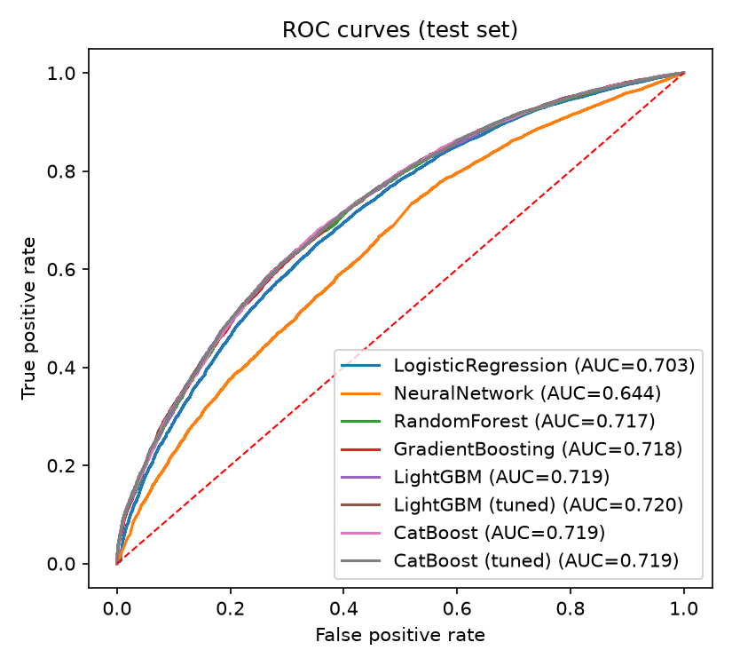

# LendingClub Loan Default & Profitability Prediction

**Applied ML · credit-risk modelling · SHAP explainability**

This is the most complete published LendingClub variant in my repositories, with Optuna tuning, SHAP explanations, saved evaluation outputs, and a Streamlit demo. Earlier variants: [baseline](https://github.com/SaieshShankar/lendingclub-default-prediction) and [tuning extension](https://github.com/SaieshShankar/ML-Miniproject).

## Saved run highlights

These figures come from the [committed run summary](results/summary.txt) and [model metadata](models/meta.json); they have not been rerun as part of this documentation update.

| Measure | Saved result |
| --- | --- |
| Train / validation / test loans | 59,500 / 10,500 / 30,000 |
| Best classifier | Tuned LightGBM; test ROC-AUC 0.720 |
| Best return regressor | Tuned CatBoost; test R² 0.032 |
| Historical selection rule | 692 test loans selected, or 2.3% |
| Selected-loan mean annualised return | About 4.6%; bootstrap 95% interval about 3.3%–5.7% |

Return figures are equal-weighted averages of per-loan annualised returns, rather than realised portfolio returns. SHAP describes model dependence, rather than causation.



UE24CS352A – Machine Learning · Mini-Project

Credit risk is the central concern of any peer-to-peer (P2P) lending investor. This project builds
machine-learning models on historical **LendingClub** loans to help an investor decide *which listed
loans are worth funding*:

| Task | Question | Models |
|------|----------|--------|
| **Classification** | Will this loan be *fully paid* or *default / charge off*? | Logistic Regression, Neural Network (MLP), Random Forest, Gradient Boosting, **LightGBM, CatBoost** (default + Optuna-tuned) |
| **Regression** | What *net annualised return (NAR)* will this loan earn? | Linear, Ridge, Neural Network (MLP), Random Forest (depth 4/8/10), Gradient Boosting, **LightGBM, CatBoost** (default + tuned) |
| **Explainability** | Which loan details drive the result, in plain English? | SHAP (grouped per loan field) + generated text explanations |
| **Loan-selection strategy** | Which loans should I invest in? | Invest in every loan whose predicted NAR ≥ threshold *M* (tuned on validation, evaluated on test) |

The approach follows *Li & Han, "LendingClub Loan Default and Profitability Prediction"* (Stanford).


---

## Repository layout

```
.
├── main.py                    # CLI: runs the whole pipeline (data → features → models → strategy)
├── app.py                     # Streamlit demo: score a single loan interactively
├── requirements.txt
├── src/
│   ├── config.py              # paths, feature groups, label & NAR settings
│   ├── data.py                # loading, filtering, labels, NAR target, train/test split
│   ├── features.py            # preprocessing pipeline (mean/zero/max imputation, one-hot, scaling)
│   ├── models.py              # model factories (hyper-parameters from the report)
│   ├── evaluate.py            # metrics, confusion matrices, ROC curves
│   ├── explain.py             # SHAP (grouped by loan field) + plain-English explanations
│   ├── tuning.py              # Optuna tuning of LightGBM / CatBoost (validation-based)
│   ├── strategy.py            # threshold search + investment simulation + plots
│   └── experiments.py         # classification / regression / strategy stages
├── scripts/generate_sample_data.py   # synthetic dataset for smoke tests & offline demos
├── tests/test_core.py         # unit tests (pytest)
├── data/                      # put the dataset here (git-ignored)
├── models/                    # saved models + meta.json (git-ignored)
└── results/                   # CSV tables and plots produced by main.py
```

## Setup

```bash
git clone https://github.com/SaieshShankar/ML-Miniproject-new.git
cd ML-Miniproject-new
python -m venv .venv && source .venv/bin/activate      # Windows: .venv\Scripts\activate
pip install -r requirements.txt
```

Requires Python 3.9+.

## Dataset

Use the public LendingClub *accepted loans* file (`accepted_2007_to_2018Q4.csv` / `.csv.gz`), e.g. the Kaggle
dataset **"Lending Club" by *wordsforthewise***. Download it and place it in `data/`.

The pipeline keeps loans **issued 2012–2015** with a **final** status (Fully Paid → label 1;
Charged Off / Default → label 0), giving ≈ 745k loans, ≈ 19 % negative. Current / Late loans are dropped
because their outcome is not yet known.

> **No dataset handy?** Generate a *synthetic* file with the same schema to test the code:
> `python scripts/generate_sample_data.py --rows 30000 --out data/sample_loans.csv`
> (results on synthetic data are not meaningful.)

## Run

```bash
# Full pipeline (classification + regression + strategy) on a 100k-loan sample – a few minutes
python main.py --data data/accepted_2007_to_2018Q4.csv.gz

# Also tune LightGBM / CatBoost with Optuna on the validation set (adds a few minutes)
python main.py --data data/accepted_2007_to_2018Q4.csv --tune --trials 25

# Use every finalised loan (needs ~16 GB RAM)
python main.py --data data/accepted_2007_to_2018Q4.csv.gz --sample-size 0

# Skip explanations / change how many test loans SHAP uses
python main.py --data data/sample_loans.csv --stages classify regress strategy
python main.py --data data/sample_loans.csv --shap-samples 500

# Only some stages / custom strategy settings
python main.py --data data/sample_loans.csv --stages regress strategy --target-return 0.04 --min-pct 2

# Unit tests
pytest -q
```

Outputs:

| File | Contents |
|------|----------|
| `results/classification_results.csv` | Precision / recall / F1 (per class + weighted) and ROC-AUC, train & test |
| `results/confusion_matrices.png`, `results/roc_curves.png` | Classifier diagnostics (test set) |
| `results/regression_results.csv` | MSE and R² per regressor, train & test |
| `results/strategy_results.csv`, `results/investment_curves.png` | Threshold *M*, % of loans selected, realised annualised return + 95 % CI |
| `results/shap_summary.png`, `results/shap_top_features.csv` | Global SHAP importance per original loan field (e.g. interest rate, DTI, FICO) |
| `results/summary.txt` | Plain-English summary of the whole run (models, strategy, main drivers) |
| `results/tuning_best_params.json` | Best Optuna parameters, boosting rounds and validation score (only with `--tune`) |
| `models/*.joblib`, `models/meta.json` | Fitted preprocessor + best classifier + best regressor + threshold |

### Live demo (for the review)

```bash
python main.py --data data/<your file>.csv     # once, to train & save models
streamlit run app.py
```

Enter a loan's details (amount, term, rate, grade, income, DTI, FICO …) → the app shows **P(fully paid)**,
the **predicted NAR**, an **INVEST / SKIP** decision based on the learned threshold, and a short
**plain-English explanation** naming the inputs that pushed the repayment chance up or down (SHAP). Fields not
entered are treated as missing and imputed exactly as during training.

## Method summary

1. **Cleaning & labels** – finalised 2012–2015 loans; `label = 1` if Fully Paid else 0.
   Only information available *at application time* is used as a feature (payments, recoveries and
   other post-origination columns are excluded to avoid label leakage).
2. **Missing values** – three strategies: *mean-set* (e.g. DTI, income), *zero-set* (e.g. delinquency counts),
   *max-set* (`k ×` column max for “months since last …” fields, so applicants without such an event
   aren't penalised).
3. **Encoding & scaling** – one-hot for categoricals (incl. 3-digit zip prefix), dates → days since epoch,
   constant columns dropped, standardisation (mean 0 / std 1). The pipeline is **fit on the training split only**.
4. **Classifiers** – Logistic Regression (L2, balanced class weights), MLP (10-10-5-3, sigmoid),
   Random Forest (200 trees, ≤ 50 features per split). Compared on weighted precision / recall / F1,
   per-class metrics and ROC-AUC.
5. **Regressors** – target is NAR = (total payment / loan amount)^(365 / days) − 1.
   Linear (shows over-fitting), Ridge (L2), MLP (20-10-5-3, ReLU, Adam), Random Forest (depth 4/8/10,
   showing the bias–variance trade-off). Compared on MSE and R².
6. **Strategy** – rank loans by predicted NAR; choose the loosest threshold *M* on the **validation** set whose
   selected loans still average the target return (default 5 %, at least 1 % of loans); report the realised
   return, share of loans selected and a 95 % bootstrap confidence interval on the held-out **test** set.

## Reference results (from the original report, full dataset)

| Model | Metric | Reported |
|-------|--------|----------|
| Random Forest classifier | weighted precision / recall | 0.89 / 0.89 |
| Random Forest regressor (depth 10) | test MSE / R² | 0.036 / 0.315 |
| Strategy (*M* = 0.132) | realised return / loans selected | ≈ 15 % / 1.76 % |

The project's saved run is summarised above. The table in this section reports reference-paper numbers, not this implementation's results.

## Improvements over the reference report

| Change | Why |
|--------|-----|
| **Train / validation / test split** (70·0.85 / 70·0.15 / 30) | The report had no dev set (its own "future work"). Model selection, probability cut-offs and the strategy threshold are now chosen on validation data; the test set is used once for the final evaluation. |
| **Class-imbalance handling for every classifier** (balanced weights; oversampling for the MLP) | In our first real run the MLP predicted "Paid Off" for every loan and the forest almost never flagged defaults. |
| **Tuned probability cut-off** (macro-F1 on validation) | A fixed 0.5 cut-off hides how well a model ranks defaults on imbalanced data. |
| **Selection by ROC-AUC / R² on validation** | Weighted F1 rewards "always predict Paid" (≈ 0.73 for a useless model). |
| **Gradient-boosting classifier & regressor** (extension) | A stronger tabular model than those in the report. |
| **LightGBM & CatBoost, with Optuna tuning** (extension) | Modern gradient-boosting benchmarks against the report's models. Trials and early stopping use the **validation** set only (ROC-AUC / R²); the number of boosting rounds comes from early stopping. Both are shown untuned and tuned, so the effect of tuning is visible. Expect modest gains over plain gradient boosting. |
| **Leakage-free features** | Only application-time columns are used. |
| **SHAP explanations + plain-English text** (extension) | Shows *why* a loan is scored as it is. The ~1,000 one-hot columns are summed back into the original loan fields so the output is readable. Kept deliberately light: one global plot, one per-loan explanation, one run summary. |
| **Bootstrap 95 % CI on strategy return** | The selected set is small, so the point estimate alone is misleading. |

**Honest note on the numbers.** The report's headline figures (weighted F1 0.89, ROC-AUC 0.94, R² 0.315,
15 % return) are much higher than what application-time features support (published LendingClub work
typically reports AUC ≈ 0.70–0.73). Because the report does not list its features we cannot verify this, but
outcome-leaking columns (payments, recoveries) are the most likely explanation. We therefore do **not**
claim to beat those figures; we claim a reproducible, leakage-free, properly validated pipeline.

## Explainability notes

- SHAP runs on a **tree model** (Random Forest, LightGBM or CatBoost). If the overall best classifier is not a tree
  model, the best tree model is saved separately and used for explanations (the app tells you which).
- SHAP shows what the model *relies on*, **not what causes default**. The text explanation only names directions
  ("pushes the repayment chance down"), not exact probability changes.
- In the app, only fields you entered are explained; everything else is imputed and ignored in the text.

## Implementation notes & deliberate choices

- **NAR formula** – we annualise with exponent `365 / days`. (The report's printed formula has the exponent
  inverted, which would not give sensible annual returns.) Very short loans are floored at 60 days and NAR
  is clipped to [−1, 1] so a few early pay-offs don't dominate the regression target (`src/config.py`).
- **Random-forest classifier** uses `min_samples_leaf=20` and balanced class weights to curb the over-fitting noted
  in the report and keep the saved model small. The MLP classifier uses ReLU (paper: sigmoid) plus minority
  oversampling, because the sigmoid network trained on imbalanced data collapsed to one class.
- **Sub-sampling** (100k loans by default) keeps run-time reasonable on a laptop; use `--sample-size 0` for all data.
- Strategy return is the *equal-weighted mean* NAR of selected loans (each loan assumed to receive the same $ amount).
- Limitations: random (not time-based) split; no macro-economic features; historical evaluation rather than a live investment backtest.
  See "Future work" in the report (test on 2016-2018 loans, add declined loans, NLP on loan descriptions).

## References

1. S. Chang, S. D.-o. Kim, G. Kondo, *Predicting default risk of Lending Club loans*, 2015.
2. K. Tsai, S. Ramiah, S. Singh, *Peer lending risk predictor*, CS229, 2014.
3. A. Gutierrez, D. Mathieson, *Optimizing investment strategy in peer to peer lending*, 2017.
4. P. Li, G. Han, *LendingClub Loan Default and Profitability Prediction*, Stanford (project report & poster).
5. F. Pedregosa et al., *Scikit-learn: Machine learning in Python*, JMLR 12, 2011.
